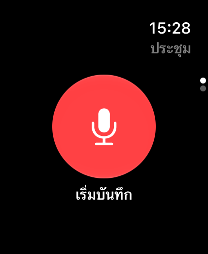
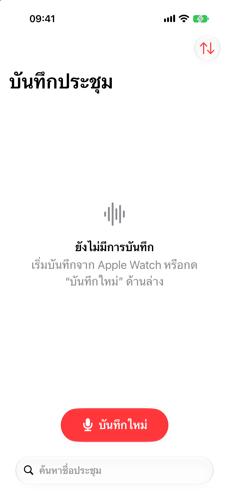
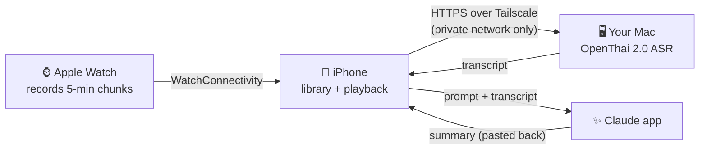

<div align="center">

# MeetingMe

**Record meetings on Apple Watch or iPhone. Transcribe Thai and English on your own Mac. No cloud, no API keys.**



&nbsp;&nbsp;&nbsp;&nbsp;


<sub>Apple Watch Ultra 4 and iPhone 17 Pro simulators. The interface is in Thai.</sub>

</div>

---

## Why MeetingMe

Most AI note-taking apps upload your meetings to someone else's server. MeetingMe keeps the whole pipeline on hardware you own:

- **Record on your wrist.** Tap once on Apple Watch and the meeting is captured, even if the meeting runs for hours.
- **Transcribe on your own Mac.** Speech-to-text runs on [OpenThai 2.0 ASR](https://huggingface.co/iapp/OpenThai2.0-ASR-Streaming), an open model built for Thai with mixed-in English. Audio travels only over your private [Tailscale](https://tailscale.com) network.
- **Summarize with the Claude app you already use.** MeetingMe builds a structured prompt and hands it to the Claude app. You paste the answer back. No API keys, no per-minute fees.

## Features

| | Feature | Status |
|---|---|---|
| ⌚️ | One-tap recording on Apple Watch, with level meter, ⭐ markers, double-tap stop and an Always-On view | ✅ Built |
| 🧩 | Crash-safe recording: audio is saved in 5-minute chunks; an interrupted recording is recovered on the next launch | ✅ Built |
| 📱 | iPhone library with search, sort, playback and delete | ✅ Built |
| 🔄 | Watch → iPhone chunk transfer; the Watch deletes a chunk only after the iPhone confirms it | ✅ Built |
| 🖥️ | macOS menu-bar app that runs the transcription server | 🚧 In progress |
| 📝 | Per-chunk transcription with retry, so a failure re-sends one chunk instead of the whole meeting | 🗓️ Planned |
| ✨ | Summary, decisions and action items via the Claude app | 🗓️ Planned |
| 📄 | Export to TXT, PDF (with correct Thai line breaking) and DOCX | 🗓️ Planned |

The full roadmap is in [tasks/todo.md](tasks/todo.md).

## How it works



### Transcription speed

Measured on an Apple M4 Pro (CPU only) with a short synthetic Thai clip. See [mac-server/BENCHMARK.md](mac-server/BENCHMARK.md).

| Language mode | Speed | English words in output |
|---|---|---|
| `th-TH` | 8.3× real time | transliterated to Thai |
| `th-mix` | 8.3× real time | kept in English |

A benchmark on real meeting audio recorded on the Watch is still to come.

## Getting started

### Requirements

- Xcode 27 with the iOS 27 and watchOS 27 SDKs
- [XcodeGen](https://github.com/yonaskolb/XcodeGen): `brew install xcodegen`
- For transcription: an Apple silicon Mac, plus `brew install uv ffmpeg`

### Build the apps

```sh
git clone https://github.com/sosaom1-hub/MeetingMe.git
cd MeetingMe
xcodegen generate
open MeetingRecorder.xcodeproj
```

Choose the `MeetingRecorder` scheme (iPhone with its embedded Watch app) and run it. To install on real devices, set `BUNDLE_PREFIX` and `DEVELOPMENT_TEAM` in [project.yml](project.yml) first. A free Apple ID works; see [docs/free-signing.md](docs/free-signing.md) for automatic weekly re-signing.

### Set up the transcription server

```sh
./mac-server/setup.sh          # Python venv + model weights (~2.6 GB)
tailscale serve --bg 18081     # expose to your tailnet only, over HTTPS
```

Then run the `MeetingRecorder Server` scheme to start the menu-bar app.

> [!WARNING]
> The server has no authentication. Keep it bound to `127.0.0.1` and published with `tailscale serve`. Never use `tailscale funnel` or router port forwarding.

### Run the tests

```sh
xcodebuild test -project MeetingRecorder.xcodeproj -scheme MeetingRecorder \
  -destination 'platform=iOS Simulator,name=iPhone 17 Pro'
```

## Project structure

```
Shared/                     Model, chunked recorder and design shared by Watch and iPhone
MeetingRecorder/            iPhone app: library, detail, recording, transfer, SwiftData
MeetingRecorder Watch App/  Watch app: recording screens and transfer
MeetingRecorder Mac/        macOS menu-bar app for the transcription server
MeetingRecorderTests/       Swift Testing unit tests
mac-server/                 Server setup script and benchmark notes
SPEC.md                     Full product specification
```

## Built with

Swift 6 (strict concurrency) · SwiftUI · SwiftData · AVFoundation · WatchConnectivity · Swift Testing · [OpenThai 2.0 ASR](https://huggingface.co/iapp/OpenThai2.0-ASR-Streaming) · [Tailscale](https://tailscale.com)

No third-party Swift packages.

## Privacy

- Recordings and transcripts are stored only on your devices.
- Audio is sent only to your own Mac, and only after you tap Transcribe.
- The app never logs audio or transcript content.
- Recording other people may require their consent. The app shows a consent reminder before recording (it can be snoozed for 24 hours).

## License

Released under the [MIT License](LICENSE).
