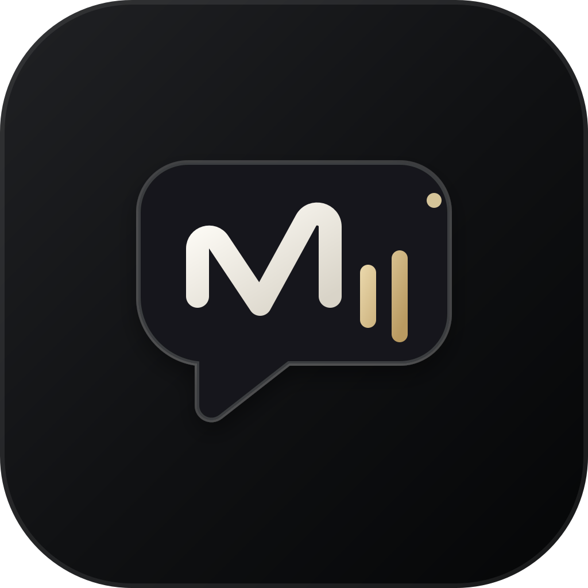

# MeetingMe brand guide



The source of truth for the logo and colors. Use these values exactly; do not pick new ones.

## Logo

| File | Use |
|---|---|
| [meetingme-icon.svg](meetingme-icon.svg) | Master artwork, 1024 × 1024, rounded corners. Use in docs, README, web. |
| [../../Shared/Assets.xcassets/AppIcon.appiconset/AppIcon.png](../../Shared/Assets.xcassets/AppIcon.appiconset/AppIcon.png) | App icon for iPhone and Apple Watch. Square, full-bleed, opaque: the OS applies its own corner mask. |

**Meaning.** A speech bubble (a meeting) holds an **M** drawn as a voice waveform, followed by two sound bars. The gold dot is the "live" light.

**Rules**
- Always place the logo on its own charcoal tile. Do not put the bubble alone on a light background.
- Keep clear space around the tile of at least ¼ of its width.
- Do not recolor, stretch, rotate, add effects, or redraw the M.
- Minimum size: 29 pt (smallest iOS icon). Below that, use the tile without the bubble outline only if a designer approves.

To regenerate `AppIcon.png` after editing the SVG: remove `rx="230"` and the edge-highlight `<rect>` (the OS masks corners), render at 1024 px, and save as an RGB PNG without alpha.

## Colors

### Brand

| Token | Hex | Role |
|---|---|---|
| `charcoal.top` | `#202124` | Icon background, gradient start |
| `charcoal` | `#101113` | Main dark background, gradient middle (`Theme.brandCharcoal`) |
| `charcoal.bottom` | `#050607` | Icon background, gradient end |
| `surface` | `#23262A` | Cards and bubbles on charcoal (`Theme.brandSurface`) |
| `ivory` | `#FFFDF8` | Primary mark and text on dark, gradient start (`Theme.brandIvory`) |
| `ivory.shade` | `#D9D4C8` | Ivory gradient end, secondary text on dark (`Theme.brandIvoryShade`) |
| `gold` | `#E7D4A7` | Accent, gradient start (`Theme.brandGold`) |
| `gold.deep` | `#B99A61` | Accent gradient end (`Theme.brandGoldDeep`) |
| `gold.dot` | `#E5D2A4` | The "live" dot |

Gradients run from the top-left to the bottom-right: charcoal `#202124 → #101113 → #050607`, ivory `#FFFDF8 → #D9D4C8`, gold `#E7D4A7 → #B99A61`.

### Functional (inside the app)

| Token | Value | Role |
|---|---|---|
| `Theme.recording` | system red | **Only** means "recording". Never use it for branding or decoration. |
| `Theme.warning` | system orange | Warnings |
| `Theme.success` | system green | Done / saved |

Brand gold is an accent, not a status color. Status always uses the system colors above so it works with Dark Mode, Increase Contrast and color-blind settings.

### Contrast (WCAG 2.x)

| Foreground | on `#101113` | on white |
|---|---|---|
| `#FFFDF8` ivory | 18.6 : 1 ✅ | 1.0 : 1 ❌ |
| `#D9D4C8` ivory.shade | 12.8 : 1 ✅ | 1.5 : 1 ❌ |
| `#E7D4A7` gold | 12.9 : 1 ✅ | 1.5 : 1 ❌ |
| `#B99A61` gold.deep | 7.1 : 1 ✅ | 2.7 : 1 ❌ |

**Ivory and gold are for dark backgrounds only.** On light backgrounds use `#101113` for text (18.6 : 1 on ivory) and keep gold to non-text decoration.

## In SwiftUI

The app UI follows system colors (light and dark) and uses brand colors sparingly: the app icon, the About screen, and the gold accent on dark surfaces. All brand colors live in `Shared/Design/Theme.swift`; never write a brand hex value anywhere else:

```swift
Text("MeetingMe")
    .foregroundStyle(Theme.brandIvory)
    .padding()
    .background(Theme.brandBackground)
```

`Theme.brandBackground` is the charcoal gradient and `Theme.brandGoldGradient` is the gold one.

## Typography

Use the system font (SF Pro / SF Compact on Watch, with the system Thai fallback) and Dynamic Type text styles. No custom fonts.
